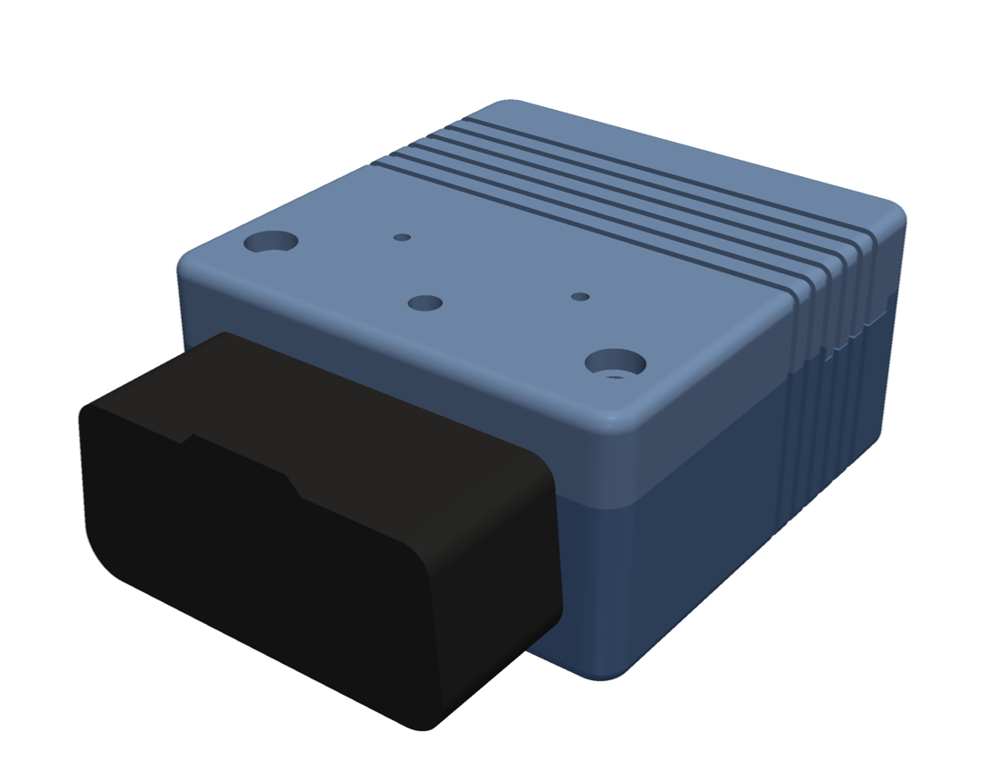

# obd-v2x-dongle

Hobby OBD-II plug-in dongle that reads vehicle data, receives ITS-G5 (802.11p) V2X messages and uploads everything over LTE.

> **Receive-only for ITS-G5.** Transmitting on the 5.9 GHz ITS band requires EN 302 571 compliant equipment (or an experimental licence from the Bundesnetzagentur). This project does not transmit V2X messages.

## Status

**Rev 2 is ordered** (2026-11-26, PCBWay, assembled; boards expected around the turn of the year). Nothing has been
built yet: rev 1 was cancelled before production in favour of rev 2, so the first rev 2 boards are also the first
test of the circuit and the firmware. Details: [`rev2/README.md`](rev2/README.md); order, parts and cost:
[`rev2/docs/bom-notes.md`](rev2/docs/bom-notes.md).

## Architecture

```
OBD-II J1962 plug
 ├─ pin 16 (+12 V) ──► reverse-polarity + TVS (ISO 7637 / 16750) ──► 3 A buck ──► 3.8 V (LTE)  ──► 3.3 V LDO (logic)
 ├─ pin 6/14 (CAN) ──► CAN transceiver ──► ESP32-C5 TWAI
 ├─ pin 7 (K-Line) ──► K-Line transceiver ──► ESP32-C5 UART
 └─ pin 4/5 (GND)

ESP32-C5-WROOM-1U ── u.FL ──► 5.9 GHz antenna   (ITS-G5 RX via esphome-its-g5, BLE for setup)
        │ UART
Quectel EC200U-EU (LTE Cat 1 + GNSS) ── LTE antenna (U.FL), GNSS patch with SAW + LNA front end, micro-SIM
1S LiPo backup cell with charger and power mux
```

### Power management
- Ignition detection (supply > ~13.2 V or CAN activity) to sleep the modem when parked
- Low-battery cutoff (~11.8 V) to avoid draining the car battery
- Cranking ride-through down to ~6 V

## Rev 2 (current)

Two stacked 45 × 45 mm boards (4 layers each, joined by 2 × 8 headers and two spacers) in a 3D-printed case of
**68.1 × 49.6 × 26.4 mm including the plug**. The carrier holds the plug, power and the LTE modem; the upper board the
ESP32-C5, the transceivers, the SIM, the charger and the GNSS patch.



## Repo layout

| Path | Contents |
|---|---|
| `rev2/` | Rev 2, ordered: `hardware/` (two KiCad 10 projects, the assembly panel, tools), `mechanical/` (stack model, case), `docs/` (BOMs, order notes) |
| `rev1/` | Rev 1, a single 52 × 64.4 mm board: fully designed and routed, cancelled before production. Kept as the reference circuit and for its bring-up procedure |
| `firmware/` | ESP32-C5 firmware (ESPHome), shared by both revisions |

## Related

- [esphome-its-g5](https://github.com/peterbaumert/esphome-its-g5) — ESP32-C5 ITS-G5 receiver component
