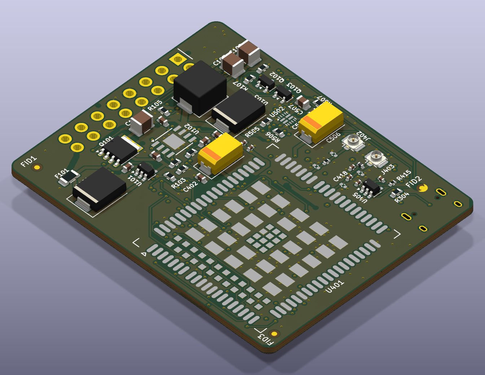

# obd-v2x-dongle

Hobby OBD-II plug-in dongle that reads vehicle data, receives ITS-G5 (802.11p) V2X messages and uploads everything over LTE.

> **Receive-only for ITS-G5.** Transmitting on the 5.9 GHz ITS band requires EN 302 571 compliant equipment (or an experimental licence from the Bundesnetzagentur). This project does not transmit V2X messages.

## Architecture

```
OBD-II J1962 plug
 ├─ pin 16 (+12 V) ──► reverse-polarity + TVS (ISO 7637 / 16750) ──► 3 A buck ──► 3.8 V (LTE)  ──► 3.3 V LDO (logic)
 ├─ pin 6/14 (CAN) ──► CAN transceiver ──► ESP32-C5 TWAI
 ├─ pin 7 (K-Line) ──► K-Line transceiver ──► ESP32-C5 UART
 └─ pin 4/5 (GND)

ESP32-C5-WROOM-1U ── u.FL ──► 5.9 GHz antenna   (ITS-G5 RX via esphome-its-g5, BLE for setup)
        │ UART
Quectel EC200U-EU (LTE Cat 1 + GNSS) ── LTE main + GNSS antennas (U.FL), nano-SIM
```

### Power management
- Ignition detection (supply > ~13.2 V or CAN activity) to sleep the modem when parked
- Low-battery cutoff (~11.8 V) to avoid draining the car battery
- Cranking ride-through down to ~6 V

## PCB (fully routed, DRC clean; manufacturing review pending)



52 x 65 mm (plus the OBD plug in front), 4 layers, parts on both sides. Top: power, LTE modem, U.FL antennas. Bottom: CAN/K-Line, ESP32-C5, SIM, USB-C.

Design review and open decisions: [`docs/design-review.md`](docs/design-review.md).

## Repo layout

| Path | Contents |
|---|---|
| `hardware/` | KiCad 10 project (schematic, PCB) |
| `firmware/` | ESP32-C5 firmware (planned) |
| `docs/` | Datasheets notes, design decisions |

## Related

- [esphome-its-g5](https://github.com/peterbaumert/esphome-its-g5) — ESP32-C5 ITS-G5 receiver component
