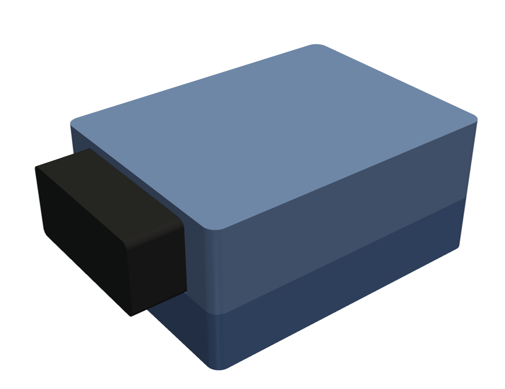
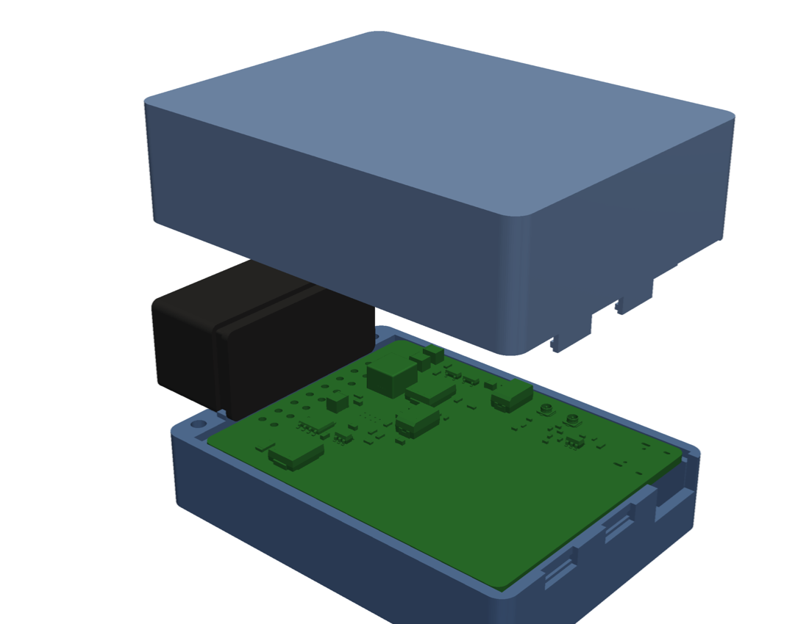

# Case

Two-part 3D-printed case, generated by [`case.py`](case.py) with [build123d](https://github.com/gumyr/build123d).




| File | |
|---|---|
| `out/case_bottom.stl`, `out/case_lid.stl` | print files |
| `out/case_bottom.step`, `out/case_lid.step` | CAD (open in Fusion 360, FreeCAD, ...) |
| `out/*.png` | previews |

```bash
pip install build123d pyvista
python mechanical/case.py --check --render
```

`case.py` exports the board's 3D model with `kicad-cli` (KiCad 10, found via `hardware/tools/kicad_env.py`) to
`build/board.step`, places ledges and ribs only where no part is near the board edge, and `--check` reports any
overlap of the case with the PCB, the parts or the OBD plug. Re-run it after board changes.

## Concept

- **Size** 56.6 × 75 × 34.7 mm, 87.8 mm long including the OBD plug that sticks out at the front.
- **Bottom shell + lid**, split at the board's top face. The board rests on ledges in the bottom shell, and the lid
  presses on its top edge. The board has no mounting holes.
- **OBD plug J201** sits entirely in front of the board. A U-shaped rib in the lid (top and both sides) and a
  straight rib in the bottom shell sit in the plug's retention groove behind its 1.5 mm rear flange. Plugging and
  unplugging load the case, not the solder joints.
- **Closing:** two M2.5 × 12 self-tapping screws from below, in the corners beside the plug, plus two hooks at the
  rear. To close, put the lid on rear first and fold it down at the front.
- **Openings:**
  - USB-C at the rear.
  - RESET and BOOT pin holes with guide tubes in the bottom (use a paper clip).
  - A Ø 3 mm light pipe for the LED: clear acrylic or PMMA rod, 11 mm long.
- **Backup cell:** pocket on the floor for a 1S LiPo, e.g. 402535 + PCM, 38 × 26 × 4.5 mm. The JST-PH lead goes
  to J501. The NTC RT501 is on the board, so it measures the case air, not the cell surface.
- **Antennas** (LTE, GNSS, 5.9 GHz): flex antennas stuck to the inside of the lid (LTE, GNSS) and the floor
  (5.9 GHz, on the ESP32 module's U.FL). There are no metal parts in the case.
- **Material:** PETG or ASA, not PLA (cars get hot inside). 2 mm walls, 3 perimeters. Print the lid upside down and
  the bottom shell standing on its floor; neither needs supports.

## Before printing the final version

Values marked `MEASURE` in `case.py` come from the Jiatel CR-PG001 drawing or are estimates. Measure them on
the real plug and on your cell:

| Parameter | Now | What to measure |
|---|---|---|
| `PLUG_W`, `PLUG_H` | 37.6 × 17.8 mm | housing outline (and its D-shape chamfers, `PLUG_R`) |
| `PLUG_Z0` | flush with the board top | housing bottom relative to the board top |
| `FLANGE`, `GROOVE_W`, `GROOVE_D` | 1.5 / 2.5 / 1.0 mm | rear flange thickness, groove width and depth |
| `CELL_*` | 38 × 26 × 4.5 mm | the cell you buy |

A test print of just the front part (plug + ribs) is worth doing before the full case.
