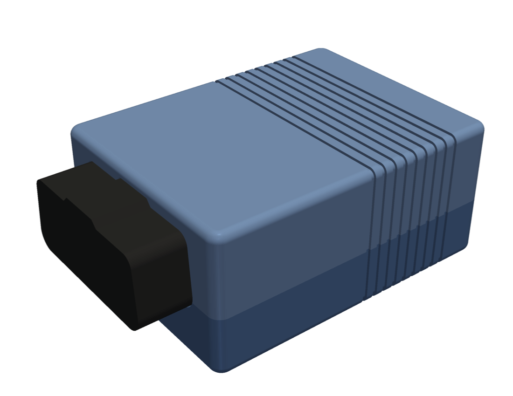
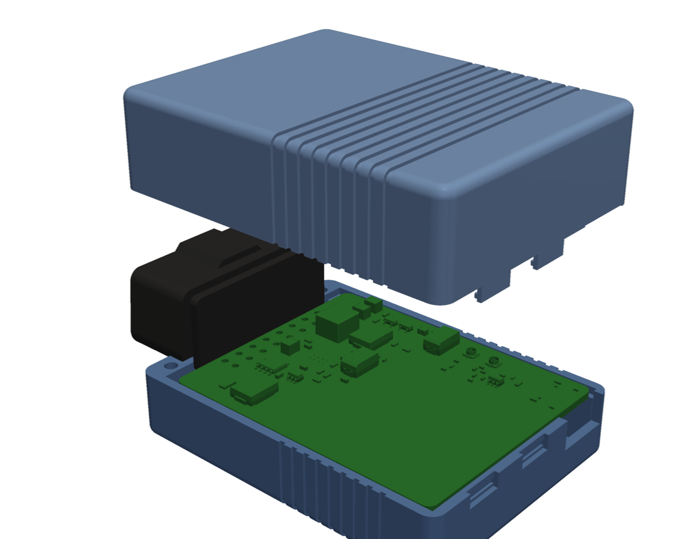

# Case

Two-part 3D-printed case, generated by [`case.py`](case.py) with [build123d](https://github.com/gumyr/build123d).




| File | |
|---|---|
| `out/case_bottom.stl`, `out/case_lid.stl` | print files |
| `out/case_bottom.step`, `out/case_lid.step` | CAD (open in Fusion 360, FreeCAD, ...) |
| `out/*.png` | previews |

```bash
pip install build123d pyvista
python rev1/mechanical/case.py --check --render
```

`case.py` exports the board's 3D model with `kicad-cli` (KiCad 10, found via `rev1/hardware/tools/kicad_env.py`) to
`build/board.step`, places ledges and ribs only where no part is near the board edge, and `--check` reports any
overlap of the case with the PCB, the parts or the OBD plug. Re-run it after board changes.

## Concept

- **Size** 56.6 × 75 × 34.1 mm, 87.4 mm long including the OBD plug that sticks out at the front. All outer edges
  are rounded: R3 on the vertical edges, R2 on the top and bottom edges (these face the bed when printing and
  print without supports).
- **Grip:** a band of nine grooves (1.2 mm wide, 0.6 mm deep, 3 mm apart) all around the case (sides, top and
  bottom), in the rear half, across the plugging direction, so the case doesn't slip in the fingers when plugging
  in or out. They print without supports in both shells' print orientation.
- **Bottom shell + lid**, split at the board's top face. The board rests on ledges in the bottom shell, and the lid
  presses on its top edge. The board has no mounting holes.
- **OBD plug J201** sits entirely in front of the board. A U-shaped rib in the lid (top and both sides) and a
  straight rib in the bottom shell sit in the plug's retention groove behind its 2.0 mm rear flange. Plugging and
  unplugging load the case, not the solder joints.
- **Closing:** two 2.5 × 12 self-tapping screws from below (Keystone 689 #4 × ½" or PT 2.5 × 12, head ≤ Ø 5.3 mm), in the corners beside the plug, plus two hooks at the
  rear. To close, put the lid on rear first and fold it down at the front.
- **Openings:**
  - USB-C at the rear.
  - RESET and BOOT pin holes with guide tubes in the bottom (use a paper clip).
  - A Ø 3 mm light pipe for the LED: Bivar PLP2-10MM pressed into the Ø 3.0 mm hole (or a clear PMMA rod, 11 mm).
- **Backup cell:** pocket on the floor for a 1S LiPo, e.g. 402535 + PCM, 38 × 26 × 4.5 mm. The JST-PH lead goes
  to J501. The NTC RT501 is on the board, so it measures the case air, not the cell surface.
- **Antennas** (LTE, GNSS, 5.9 GHz): flex antennas stuck to the inside of the lid (LTE, GNSS) and the floor
  (5.9 GHz, on the ESP32 module's U.FL). There are no metal parts in the case.
- **Material:** PETG or ASA, not PLA (cars get hot inside). 2 mm walls, 3 perimeters. Print the lid upside down and
  the bottom shell standing on its floor; neither needs supports.

## Before printing the final version

The plug values in `case.py` come from the CR-PG001 drawing (Elecbee's PDF, same part as Jiatel's), read
from the PDF's vector data. Check them on the real plug, and measure your cell:

| Parameter | Now | What to check |
|---|---|---|
| `BODY_W`, `BODY_W_TOP`, `PLUG_H` | 40.26 / 37.4 × 17.8 mm | D-shaped body: width on the board side / key side, height |
| `KEY_W`, `KEY_H` | 13 × 1.5 mm | key bump on top |
| `FLANGE_T`, `FLANGE_W`, `FLANGE_Z` | 2.0 mm, 37.6 × 17.2 mm | rear flange |
| `GROOVE_W`, `NECK_W`, `NECK_Z` | 2.0 mm, 33.6 × 14.0 mm | groove behind the flange |
| `PLUG_REAR` | 2.25 mm in front of the pin 1–8 leg centres | rear face to the nearer leg row |
| `PLUG_Z0` | 1.0 mm below the board bottom | how far the leg tips stick out (they end level with the housing bottom) |
| `CELL_*` | 38 × 26 × 4.5 mm | the cell you buy |

Solder J201 with the board and the plug lying in the bottom shell: the shell then sets the plug's height.

Test-print just the plug end first: `python rev1/mechanical/case.py --fit-test` writes `out/fit_test_plug_end.stl`
(front 12 mm of both shells behind the board edge, in print orientation, ~14 cm³).
