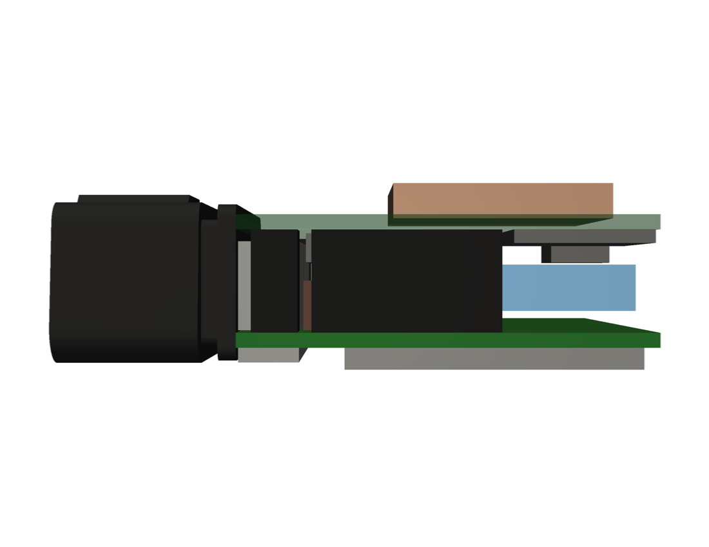

# Rev 2: two stacked boards in a 25 mm case

Status: **design brief, 3D stack model and first schematics for both boards; no layout yet.** Rev 1 (`../rev1/`) is the board in production and stays as it is.
Rev 2 lives in this folder (`hardware/`, `mechanical/`, `docs/` once they exist). The firmware (`../firmware/`) is
shared.

## Goal

The size of a commercial OBD tracker: about **68 × 50 × 25 mm including the plug**, instead of rev 1's
87.4 × 56.6 × 34.1 mm. Same functions as rev 1 except for the changes under "Decisions".

## How it gets smaller

Rev 1 is one 52 × 64.4 mm board. The 18 mm above it (the height of the OBD plug) is mostly empty, and parts up to
10 mm tall hang below it. Rev 2 uses that space:

- **Same OBD plug** (CR-PG001, 90° through-hole), still entirely in front of the board edge.
- **Two boards of about 45 × 45 mm**, stacked, joined by board-to-board headers.
- **Carrier board** (lower): the plug, and the LTE module flat on the underside. Nothing else below the board is
  taller than the module (2.4 mm).
- **Upper board**: sits about 11 mm above the carrier, inside the plug's own height.

### Height budget (z = 0 at the carrier's bottom face)

| From | To | What |
|---|---|---|
| −4.3 | −2.7 | floor, 1.6 mm |
| −2.7 | 0 | EC200U (2.4 mm) + 0.3 mm clearance; the plug's leg tips reach −2.0 |
| 0 | 1.6 | carrier board |
| 1.6 | 12.6 | gap between the boards, 11.0 mm: carrier top-side parts, the backup cell, upper-board underside parts |
| 12.6 | 14.2 | upper board |
| 14.2 | 18.5 | GNSS patch (4 mm) + clearance; the plug's key ends at 17.3 |
| 18.5 | 20.5 | roof, 2.0 mm |

Total **24.8 mm**.

- **11.0 mm is the Raspberry Pi HAT spacing:** a 2.54 mm header (2.5 mm base) in an 8.5 mm socket, held by
  M2.5 × 11 mm spacers. Two spacers sit in the front corners.
- **The plug sits 2.0 mm below the carrier's bottom face** (rev 1: 1.0 mm). Its leg bends then end 1.1 mm under
  the upper board instead of touching it. The leg tips stick out 2.0 mm below the carrier, inside the space the
  modem needs anyway, and the bends stay 0.4 mm above the carrier's top face.

### Footprint

- Width: 45 mm board + 2 × 0.3 mm gap + 2 × 2 mm wall = **49.6 mm**.
- Length: 2 mm rear wall + 0.3 mm gap + 45 mm board + 0.35 mm + 20 mm plug = **67.7 mm**. The case front ends at the
  plug's retention groove, as in rev 1.

### Does it fit? (part areas from the rev 1 board)

One side of a 45 × 45 mm board is 2025 mm². Rev 1 uses 1272 mm² of parts on top and 1047 mm² below, on 3349 mm².

| Part | Size | Height | Goes on |
|---|---|---|---|
| EC200U-EU | 29 × 32 mm | 2.4 mm | carrier, underside |
| ESP32-C5-WROOM-1U | 18 × 21 mm | 3.4 mm | upper board, underside |
| Micro-SIM holder | about 16 × 15 mm | 1.45 mm | upper board, underside, at the left edge (slot in the case) |
| Buck inductor | 7 × 7 mm | 4.8 mm | carrier, top side |
| 220 µF tantalums | 7 × 4 mm | 3.1 mm | carrier, top side |
| USB-C | 9 × 8 mm | 3.3 mm | upper board, rear edge |
| Plug legs | 32 × 7 mm | through-hole | carrier, front edge, blocks both sides |

## Board split

Decided by area: with everything except the ESP32 on the carrier, its free area would be about 65 % full and the
upper board's about 9 %. With the split below it is about 45 % and 26 % (courtyard areas from the rev 1 board).

**Carrier:** J201 with the bus protection at its pins (CAN TVS, K-line capacitor and TVS), input protection, buck,
3.3 V regulator, EC200U with its supply caps, level shifter, LTE U.FL, GNSS U.FL (jumper to the upper board), and
the whole battery circuit: charger, power mux, cell connector, NTC. The battery circuit sits here because the
modem's supply current then never has to cross the connectors.

**Upper board:** ESP32-C5 module, USB-C, LED, RESET / BOOT buttons, the CAN and K-line transceivers, the micro-SIM
holder with its resistors and capacitors, and the ceramic GNSS patch on the top side with its front end and a
U.FL for the jumper.

**Across the connectors** (two 2 × 8, 32 pins): 18 lines, 3 × 3.3 V, 1 × VSYS 3.8 V and 10 × GND.

| Lines | Count |
|---|---|
| CANH, CANL (a facing pin pair), K_LINE, VIN_PROT (vehicle voltage for the K-line pull-up) | 4 |
| Modem UART TX / RX / RTS / CTS | 4 |
| PWRKEY, RESET, STATUS, LTE power enable | 4 |
| SIM VDD / RST / CLK / DATA | 4 |
| VIN sense, USB VBUS | 2 |

The pin lists are `STACK_A` / `STACK_B` in `hardware/tools/gen_schematic.py`.

## Schematics

Two KiCad 10 projects, generated like rev 1's (edit `hardware/tools/gen_schematic.py`, then run it):

| Project | Sheets |
|---|---|
| `hardware/carrier/obd-v2x-carrier` | power, vehicle, lte, battery, stack_carrier |
| `hardware/upper/obd-v2x-upper` | mcu, xcvr (transceivers), sim, stack_upper |

```bash
python rev2/hardware/tools/gen_schematic.py     # writes both projects
python rev2/hardware/tools/check_stack.py       # same net on mating connector pins, nothing shared left uncrossed
python rev2/hardware/tools/check_vs_rev1.py     # both boards joined = rev 1's circuit, apart from the listed changes
kicad-cli sch erc rev2/hardware/carrier/obd-v2x-carrier.kicad_sch
kicad-cli sch erc rev2/hardware/upper/obd-v2x-upper.kicad_sch
```

State: ERC 0 violations on both boards, `check_stack.py` passes (21 nets cross), and `check_vs_rev1.py` confirms
that the two boards joined through the connectors are connected exactly like rev 1's reviewed netlist, apart from
the intended changes. The circuits are rev 1's with
these changes: eSIM and SIM switch removed (IO12 is a spare test pad), micro-SIM holder, side-entry battery
connector, the two board-to-board connectors with spacer holes.

Not done yet:

- **GNSS front end and patch** on the upper board (needs symbols and footprints for the SKY65943-11 and the patch).
  The carrier still has rev 1's GNSS U.FL with antenna bias.
- **Micro-SIM footprint:** the schematic uses KiCad's JAE footprint as a placeholder. Draw the Molex 78646-3001
  footprint from its drawing before layout.
- Layout of either board.

## Decisions (2026-11-20)

- **Backup battery: kept**, with a smaller cell (about 200 mAh, 5 mm thick) lying between the boards.
- **K-line / LIN: kept.** The dongle stays a general OBD device, not CAN-only.
- **eSIM: dropped.** No MFF2 footprint and no SIM switch (rev 1's U403, U404, SIM_SEL); the nano-SIM holder goes
  straight to the modem.
- **SIM: micro-SIM (3FF), push-in holder at the board edge**, reachable through a slot in the case without
  opening it. Rev 1 has a nano-SIM holder.
- **GNSS antenna: a ceramic patch soldered on the upper board**, replacing rev 1's cabled active antenna. The modem
  is on the carrier, so a short U.FL jumper carries the signal between the boards.

## Assumed unless changed

- Both boards 4 layers, 1.6 mm, 45 × 45 mm.
- The stack is held by two screws with 11 mm spacers (or by the case), not by the header friction.
- USB-C, LED and the two buttons as in rev 1, on the upper board.
- Battery space sized for a 5.2 × 20 × 30 mm cell, so more than one product fits.
- Same ESP32-C5 module and, where possible, the same GPIO assignment, so the firmware stays shared.

## Stack model

`python rev2/mechanical/stack.py --render` places the plug, both boards and their big parts as boxes, checks the
clearances and prints the case envelope: **49.6 × 68.1 × 24.8 mm including the plug, check passed.**




What the placement shows:

- Carrier underside: only the EC200U (and the plug's leg tips at the front).
- Carrier top: the two header sockets along the sides, buck inductor, tantalum, TVS and the battery connector in
  the front half.
- The cell lies across the rear half, on carrier parts up to 2.0 mm tall.
- Upper underside: ESP32-C5 module in the front half (its U.FL end towards the plug), USB-C at the rear edge, the
  micro-SIM holder at the left rear edge (the card slot is then 11 mm above the carrier).
- Upper top: the 25 mm GNSS patch.
- No clearance is below 0.3 mm. The outlines marked CHECK in the script are estimates; confirm them from the
  drawings.
- **Connector orientation:** sockets on the carrier's top side, headers on the upper board's bottom side, same
  rotation. KiCad numbers its socket footprint mirrored to its header footprint, so the flipped header puts pin 1
  on pin 1 (checked against both SMD footprints).

## Still open

- **GNSS front end:** the commercial tracker this layout follows has its own GNSS receiver chip directly under
  the patch, so its antenna path is a few millimetres. Ours is longer: patch on the upper board, receiver inside the
  modem on the carrier, a jumper cable between them. Plan: SAW filter + LNA right at the patch, powered through the
  jumper by rev 1's 3.3 V bias switch (the patch then behaves like rev 1's active antenna). Check the EC200U
  hardware design guide and rev 1's GNSS results before fixing the parts.
- **5.9 GHz and LTE antennas:** flex antennas on the case walls as in rev 1. The space is tighter, so check that
  they fit and stay away from the modem shield.

## Before any layout

- Bring up the rev 1 boards (expected mid-December 2026) and carry every fix into rev 2.
- Confirm the parts under "Parts found" against their drawings and current stock.
- Two boards mean two PCB orders and two assembly jobs. Get a quote before committing.

## Parts found (web research, 2026-11-20)

Digi-Key stock and prices were read from live pages. LCSC stock could not be read reliably, so check it before
ordering. Nothing here is in a schematic yet.

Sourcing rule: only parts that should still be buyable when the boards are built: distributor stock (Digi-Key,
Mouser, LCSC) or a regular shop, and standard formats with more than one maker. No eBay or marketplace-only items.

### Board-to-board connectors (11 mm stack)

| Option | Parts | Stack | Notes |
|---|---|---|---|
| **Pick: 2.54 mm SMD header + SMD socket, 2 × 8** | Hanxia HX PZ2.54-2x8P TP (LCSC C32713288) + HX PM2.54-2x8P TP (C41427537). Second source: Hong Cheng HC-PZ254-11L-2x8PS (C42163086) + HC-PM254-8.5H-2x8PS (C22436156) | 11.0 mm = 8.5 mm socket + 2.5 mm header base (sum of the listed heights, check the drawings) | 3 A per pin, about $0.60 per pair. Friction only: hold the boards with 11 mm spacers or the case, not with the connectors |
| Harwin Archer Kontrol 1.27 mm, 16 pins | M55-6001642R + M55-7021642R | 11.1 mm (Digi-Key listing) | Shrouded and polarised, 1.2 A per pin, about $4 per pair, thin stock (187 of the male half) |

Plain 2.0 mm and 1.27 mm header pairs only reach about 6–8 mm. Samtec SFM / TFM has a 9.91 mm height that is not
stocked.

### GNSS

From Quectel's EC200U Hardware Design V1.0 (2021) and QuecOpen Hardware Design V1.0 (2023); the newest revision
was not checked:

- Passive and active antennas are both supported. The module has its own SAW and LNA behind ANT_GNSS.
- An external LNA should have less than 17 dB gain and the active antenna a noise figure under 1.5 dB.
- Quectel asks for more than 40 dB isolation between the GNSS and main antennas. A dongle this small will not
  reach that, which is the reason for a filter right at the patch.
- GPS, GLONASS, Galileo, BeiDou and QZSS, L1 band only (1559–1609 MHz).
- Reference circuit: pi network and 100 pF DC block at the pin, bias through 10 Ω and 47 nH (rev 1 uses 27 nH).

| Part | Pick | Notes |
|---|---|---|
| Patch | **Taoglas CGGBP.25.4.A.02**, 25 × 25 × 4 mm, GPS / Galileo / BeiDou / GLONASS, about $6.70, 6,400 at Digi-Key | Tuned on a 70 × 70 mm ground plane; on 45 × 45 mm expect a small frequency shift and roughly 1–2 dB less gain (rule of thumb). Pin-fed: hand-soldered after reflow, with adhesive tape. CGGBP.18.4.A.02 (18 mm) only if space forces it |
| Front end | **Skyworks SKY65943-11**: SAW + LNA + SAW in 2.5 × 2.5 mm, 16 dB gain, noise figure 1.7 dB, about $3.20, 42,000 at Digi-Key | Supply 1.62–3.3 V, so drop the 3.3 V bias a little. Check the current datasheet revision |
| Cheaper front end | Murata SAFFB1G56AC0F0A or SAFFB1G56KB0F0A (SAW, LCSC only), then Infineon BGA725L6 (20 dB, 0.65 dB, $0.41) | Gain is slightly over Quectel's 17 dB limit: add a 2–3 dB pad at the module. SAW passband for BeiDou not confirmed |

SAW first, then LNA, because the LTE transmitter is centimetres away and would overload an unfiltered LNA. Make
the front end bypassable (0 Ω link, bias off) so a bare patch can be compared on the real board.

### Micro-SIM holder

**Molex 78646-3001**: micro-SIM, push in / pull out, 1.45 mm above the board, €1.09, 113,000 in stock at Digi-Key
(2026-11-20). JAE SF53S006VCBR2000 (KiCad has its footprint) is the same style but out of stock until January 2027;
GCT SIM7050-6-0-00-A is in stock but 2.45 mm tall.

### Backup cell and its connector

| Cell | Size (T × W × L) | Capacity | Connector | Notes |
|---|---|---|---|---|
| **Pick: PKCELL LP402025** (BerryBase, Tinytronics; Adafruit 1317 is the same format) | 4.05 × 20 × 25.5 mm | 150 mAh | JST-PH fitted | PCM with a named protection IC, about €3.30. Out of stock at both shops when checked |
| Eckstein LP521630 (ZB07003) | 5.2 × 16 × 30 mm | 250 mAh | JST-PH fitted | In stock at the shop, from €4.95. 0.2 mm over the 5.0 mm target; the shop page does not state the PCM, so check on arrival |
| ampul.eu 502025 (AM5932) | 5.0 × 20 × 25 mm | 200 mAh | not stated | Protection chip, €6.70 |
| Jauch LP402025JU + PCM (Digi-Key Marketplace) | 4.4 × 22 × 27 mm | 140 mAh | bare wires | About €10, ships separately |

- **PCB connector: JST S2B-PH-SM4-TB** (side entry, 5.5 mm above the board, LCSC C295747) instead of rev 1's vertical
  header (about 10 mm mated). The cell lies beside it, not over it.
- JST-PH polarity is not standardised: measure every cell before plugging it in (pin 1 = + on our board).
- Every cell found is a standard LiPo: charge 0–45 °C, discharge about −20 to 60 °C. No small cell rated for a hot
  cabin is buyable off the shelf. Keep rev 1's NTC charge window and 4.10 V float.
- These cells and their protection circuits are rated for roughly 150–450 mA. Check that against the modem's peak
  current on battery (rev 1 already limits battery operation to LTE and relies on the 220 µF bulk capacitor).

