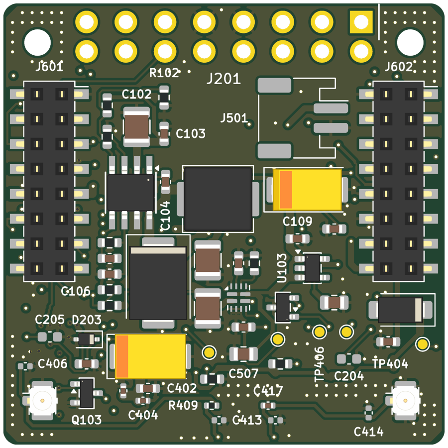
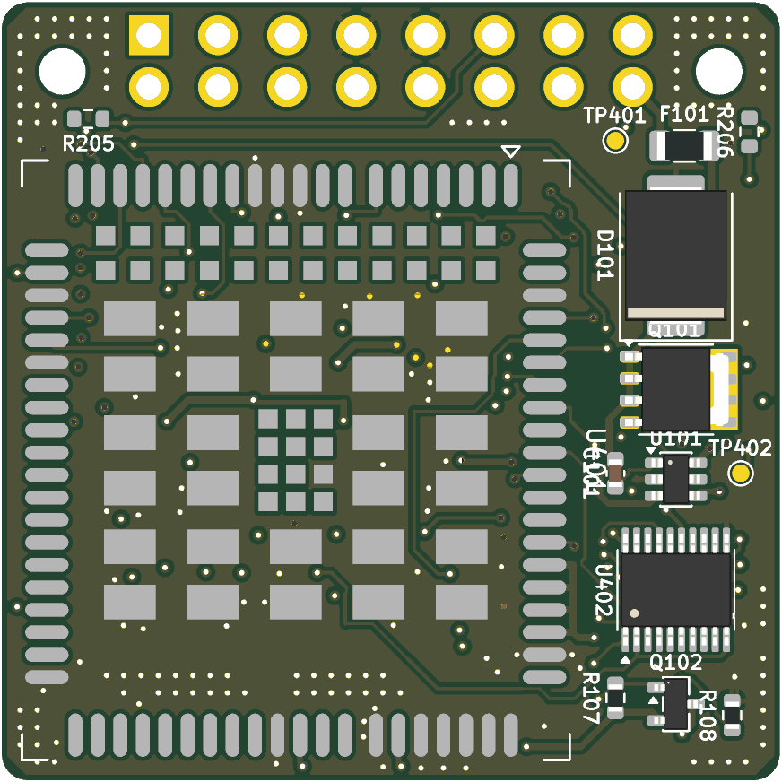
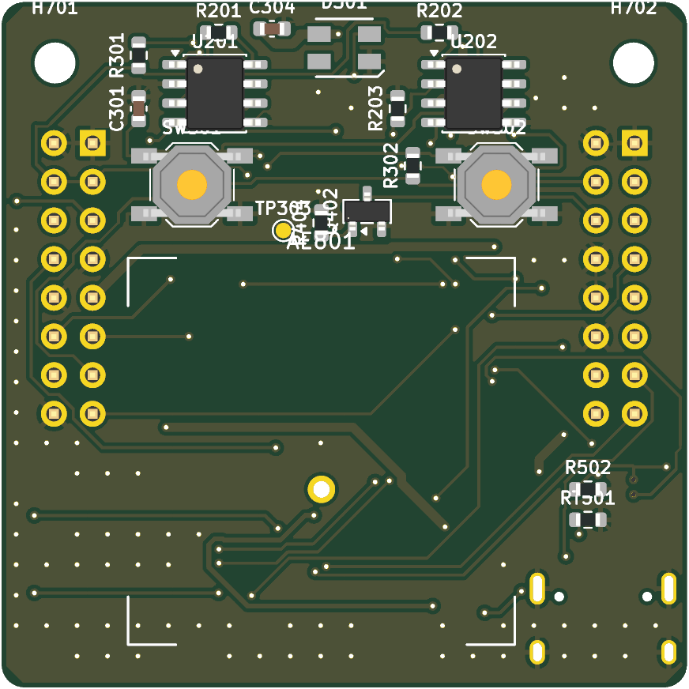
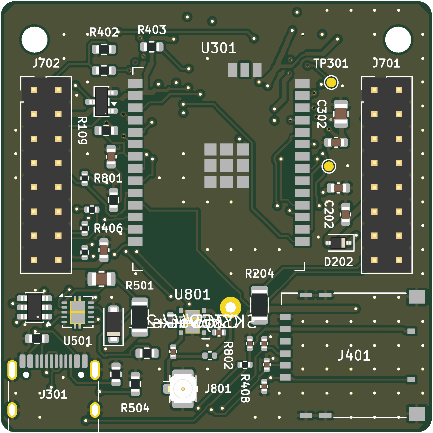
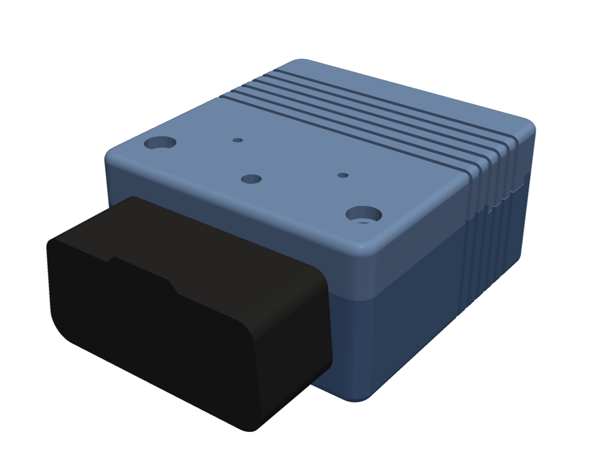
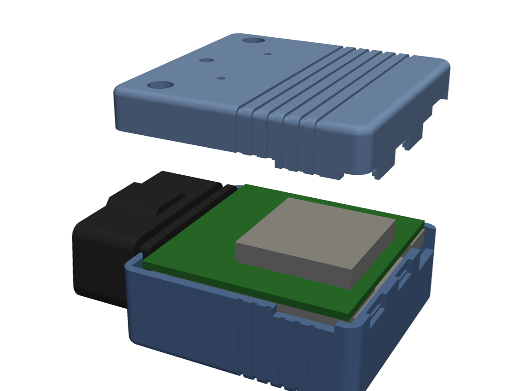
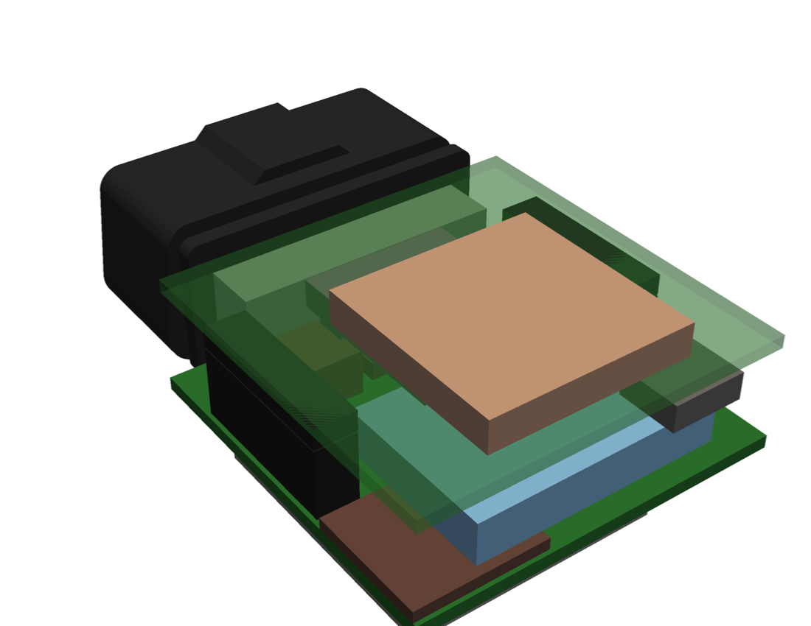

# Rev 2: two stacked boards in a 25 mm case

Status: **schematics for both boards, a 3D stack model, a first case, and both boards routed as drafts (nothing
unconnected, no rule errors). Not reviewed for ordering.** Rev 1 (`../rev1/`) is the board in production and stays as it is.
Rev 2 lives in this folder (`hardware/`, `mechanical/`, `docs/` once they exist). The firmware (`../firmware/`) is
shared.

## Goal

Close to the size of a commercial OBD tracker (about 67 × 50 × 25 mm): **68.1 × 49.6 × 26.4 mm including the plug**, instead of rev 1's
87.4 × 56.6 × 34.1 mm. Same functions as rev 1 except for the changes under "Decisions".

## How it gets smaller

Rev 1 is one 52 × 64.4 mm board. The 18 mm above it (the height of the OBD plug) is mostly empty, and parts up to
10 mm tall hang below it. Rev 2 uses that space:

- **Same OBD plug** (CR-PG001, 90° through-hole), still entirely in front of the board edge.
- **Two boards of about 45 × 45 mm**, stacked, joined by board-to-board headers.
- **Carrier board** (lower): the plug, and the LTE module flat on the underside. Nothing else below the board is
  taller than the module (2.6 mm at most).
- **Upper board**: sits 12 mm above the carrier, inside the plug's own height.

### Height budget (z = 0 at the carrier's bottom face)

| From | To | What |
|---|---|---|
| −4.5 | −2.9 | floor, 1.6 mm |
| −2.9 | 0 | EC200U (2.4 ± 0.2 mm) + 0.3 mm clearance; the plug's leg tips reach −1.0 |
| 0 | 1.6 | carrier board |
| 1.6 | 13.6 | gap between the boards, 12.0 mm: carrier top-side parts, the backup cell, upper-board underside parts |
| 13.6 | 15.2 | upper board |
| 15.2 | 19.9 | GNSS patch (4.0 ± 0.4 mm) + clearance; the plug's key ends at 18.3 |
| 19.9 | 21.9 | roof, 2.0 mm, with a 1 mm pocket over the patch's feed-pin head |

Total **26.4 mm**.

- **The gap is 12.0 mm, set by M2.5 × 12 mm spacers** in the two front corners. The connectors must not bottom
  out first. A surface-mount header and socket stand on their leads and bottom out at 12.1 ± 0.4 mm, which would
  bow the boards. So the upper board carries a through-hole header (2.5 mm base, flat on the board) and the
  carrier a surface-mount socket (top 8.9 mm above its board): 11.4 mm, 11.8 at most, 0.6 mm short of bottoming.
  The header pins still reach 5.4 mm into the socket.
- **The plug sits as in rev 1**, 1.0 mm below the carrier's bottom face. Its legs end 1.0 mm under the upper
  board (drawing: upper leg row 13.2 mm above the housing bottom, legs 0.8 mm thick).

### Footprint

- Width: 45 mm board + 2 × 0.3 mm gap + 2 × 2 mm wall = **49.6 mm**.
- Length: 2 mm rear wall + 0.3 mm gap + 45 mm board + 0.35 mm + 20 mm plug = **67.7 mm**. The case front ends at the
  plug's retention groove, as in rev 1.

### Does it fit? (part areas from the rev 1 board)

One side of a 45 × 45 mm board is 2025 mm². Rev 1 uses 1272 mm² of parts on top and 1047 mm² below, on 3349 mm².

| Part | Size | Height | Goes on |
|---|---|---|---|
| EC200U-EU | 28 × 31 mm | 2.4 ± 0.2 mm | carrier, underside |
| ESP32-C5-WROOM-1U | 18 × 21 mm | 3.4 mm | upper board, underside |
| Micro-SIM holder | about 16 × 15 mm | 1.45 mm | upper board, underside, at the left edge (slot in the case) |
| Buck inductor | 7 × 7 mm | 4.8 mm | carrier, top side |
| 220 µF tantalums | 7 × 4 mm | 3.1 mm | carrier, top side |
| USB-C | 9 × 8 mm | 3.3 mm | upper board, rear edge |
| Plug legs | 32 × 7 mm | through-hole | carrier, front edge, blocks both sides |

## Board split

Decided by area: with everything except the ESP32 on the carrier, its free area would be about 65 % full and the
upper board's about 9 %. With the split below it is about 45 % and 26 % (courtyard areas from the rev 1 board).

**Carrier:** J201 with the bus protection at its pins (CAN TVS, K-line capacitor and TVS), input protection, buck,
3.3 V regulator, EC200U with its supply caps, level shifter, LTE U.FL, GNSS U.FL (jumper to the upper board), the
cell connector and the power mux. The mux and the cell connector sit here because the modem's supply current then
never has to cross the connectors. 73 parts.

**Upper board:** ESP32-C5 module, USB-C, LED, RESET / BOOT buttons, the CAN and K-line transceivers, the micro-SIM
holder with its resistors and capacitors, the cell charger with its NTC (only 70 mA of charge current crosses the
stack; the NTC sits over the cell), the VIN sense divider, the open-collector drivers for the modem's PWRKEY and
RESET_N, and the ceramic GNSS patch on the top side with its front end and a U.FL for the jumper. 65 parts.

The carrier is the crowded one (the modem takes most of its underside, the cell limits part height over half of
its top), so everything that does not have to be next to the plug, the modem or the supply path is upstairs.

**Across the connectors** (two 2 × 8, 32 pins): 18 lines, 3 × 3.3 V, 1 × VSYS 3.8 V and 10 × GND.

| Connector | Lines |
|---|---|
| left (J601 / J701): the plug's bus pins and the modem's UART side | CANH, CANL (a facing pin pair), K_LINE, VIN_PROT (vehicle voltage for the K-line pull-up), modem UART TX / RX / RTS / CTS, STATUS |
| right (J602 / J702): the modem's SIM and power-key side | PWRKEY and RESET_N (open-collector lines), LTE power enable, USB VBUS, SIM VDD / RST / CLK / DATA, VSYS 3.8 V, VCELL (charger to cell) |

The pin lists are `STACK_A` / `STACK_B` in `hardware/tools/gen_schematic.py`.

## Schematics

Two KiCad 10 projects, generated like rev 1's (edit `hardware/tools/gen_schematic.py`, then run it):

| Project | Sheets |
|---|---|
| `hardware/carrier/obd-v2x-carrier` | power, vehicle, lte, battery (cell connector, power mux), stack_carrier |
| `hardware/upper/obd-v2x-upper` | mcu, xcvr (transceivers), sim, gnss, charger, sense, keys, stack_upper |

```bash
python rev2/hardware/tools/gen_schematic.py     # writes both projects
python rev2/hardware/tools/check_stack.py       # same net on mating connector pins, nothing shared left uncrossed
python rev2/hardware/tools/check_vs_rev1.py     # both boards joined = rev 1's circuit, apart from the listed changes
kicad-cli sch erc rev2/hardware/carrier/obd-v2x-carrier.kicad_sch
kicad-cli sch erc rev2/hardware/upper/obd-v2x-upper.kicad_sch
```

State: ERC 0 violations on both boards, `check_stack.py` passes (21 nets cross), and `check_vs_rev1.py` confirms
that the two boards joined through the connectors are connected exactly like rev 1's reviewed netlist, apart from
the intended changes. The circuits are rev 1's with
these changes: eSIM and SIM switch removed (IO12 is a spare test pad), micro-SIM holder, side-entry battery
connector, the two board-to-board connectors with spacer holes, and the GNSS patch with its front end.

GNSS on the upper board (sheet `gnss`): patch -> SKY65943-11 -> 33 pF DC block -> U.FL J801, joined by a jumper
cable to the carrier's GNSS socket J403. The front end is powered on the upper board, from the MCU pin that
switches the modem on (LTE_PWR_EN, 3 mA) through 100 Ω and 100 nF: about 3.0 V, under the part's 3.3 V limit, and
only while the modem is on. Its enable pin is tied to that supply. So the coax carries no DC and rev 1's antenna
bias switch (U405 with L401, C418, C419, C420, R415) is gone. R802 (not fitted) is a bypass link for trying the
bare patch.

New footprints, each drawn from the manufacturer's drawing (sources in `hardware/lib/gen_footprints.py`):
Molex 78646-3001 micro-SIM holder, Skyworks SKY65943-11, Taoglas CGGBP.25.4.A.02 patch.

Not done yet:

- **Placement review and routing of both boards** (see "Boards"), including the copper clearances around the
  patch's feed pin and ground vias under the front end.
- **Footprint review against real parts:** the three new footprints come from the drawings and have not been
  checked on paper prints or parts. The SKY65943-11's ground pad sizes and the patch's single 1.8 mm pad (the data
  sheet asks for 1.2 mm on top, 2.2 mm on the bottom) are my choices.
- **GNSS details to confirm:** whether the SKY65943-11's RF pins carry DC (the data sheet does not say; a DC
  block sits on its output for that reason), and ESD protection at the patch (the part is rated only 250 V HBM).

## Boards

`<KiCad>/bin/python rev2/hardware/tools/gen_pcb.py carrier|upper` builds each board from its schematic: 45 × 45 mm
outline, rules, all footprints with their nets, ground pours. `--force` regenerates a board and loses any routing.

| Board | Layers | Why |
|---|---|---|
| carrier | 4 | The modem has pads under its body and the LTE antenna line needs a ground layer right below it |
| upper | 2 | The ESP32's radio is inside its module; the only RF runs are a few millimetres at the GNSS front end. Go to 4 layers only if it does not route cleanly |

No paid impedance control: the antenna lines are designed to the fab's standard stack-up. ENIG on the carrier (flat
pads for the modem); decide the upper board's finish from a quote.

Placement so far:

- **The parts that define the stack are placed as in the stack model:** plug, connectors, spacer holes, modem,
  ESP32 module, USB-C, micro-SIM holder, GNSS patch and front end, and the carrier's tall parts (battery connector,
  inductor, tantalums) in its front half.
- **Every other part is placed automatically** next to a part it shares a net with, and only where it fits by
  height: at most 2.9 mm under the cell, 2.65 mm on the carrier's underside, 0.7 mm on the upper board's underside
  over the plug legs. The heights are a table in `gen_pcb.py` (by footprint): data-sheet maxima for the tall parts,
  typical values for the rest. A starting point, not
  a layout.
- **Antenna sockets:** LTE and GNSS U.FL in the carrier's rear right corner, beside the cell.
- **The lid side of the upper board carries what must be reached or seen:** the two buttons and the LED.
  The case lid needs pin holes and a light pipe there.
- **Changes the placement forced:** the connectors sit 0.6 mm inside the board edges (their SMD pads need 8.2 mm);
  the buck regulator uses the footprint without thermal vias, because the modem's pads are on the other side; the
  input TVS is on the carrier's underside beside the modem; the patch sits 1.5 mm left of centre so the USB-C
  socket's legs are not under it.

- **Modem orientation:** antenna pins at the rear, next to the LTE and GNSS sockets in the rear corners; UART,
  status and supply pins on its left side, where a strip of the underside stays free (level shifter, input TVS);
  SIM and power-key pins at the front and right. The connector pins are assigned to match.

### Routing

```bash
FREEROUTING_JAR=<freerouting-2.x.jar> <KiCad>/bin/python rev2/hardware/tools/autoroute.py upper   # Freerouting, Java 25
<KiCad>/bin/python rev2/hardware/tools/stitch.py upper        # GND vias where the two pours overlap
<KiCad>/bin/python rev2/hardware/tools/route_unconnected.py carrier|upper   # single connections with maze.py
```

- **Both boards are routed as drafts.** DRC on each: 0 unconnected, schematic parity 0, no rule errors; what
  remains is silkscreen overlap (cosmetic, no reference placement pass yet) and a few thermal-relief notes.
- **Upper board:** `autoroute.py`, `repair.py`, `stitch.py`. Freerouting routes every net including GND.
- **Carrier:** `autoroute.py`, `route_unconnected.py`, `repair.py`, `finish.py`, `stitch.py`, `islands.py`, then
  hand edits on the routed board: two parts slid aside so the power mux's ground pin could go straight up, ground
  pads given their own via after pushing a signal track aside, one track moved away from a supply via. It took ten
  placement rounds to get there; what made the difference was moving circuits to the upper board and placing the
  small parts of the buck regulator and the power mux by hand at their pins.
- **From here on the two `.kicad_pcb` files are the source.** `gen_pcb.py --force` rebuilds the placement but
  loses the routing and the hand edits; change the boards in KiCad or with the tools below.
- **Rules:** the carrier's supply tracks are 0.4 mm (rev 1: 0.6 mm). Vehicle-voltage nets keep 0.2 mm clearance;
  the 3.8 V supply nets use the board's 0.15 mm.
- **Review before ordering:** this is autorouted copper on a first placement. Check the buck's switching loop,
  the supply track widths (widen or pour where there is room), the LTE and GNSS lines, and the short RF runs at
  the GNSS front end. Then place the references on the silkscreen.

| Carrier, top | Carrier, underside | Upper, top | Upper, underside |
|---|---|---|---|
|  |  |  |  |

| Tool | What it does |
|---|---|
| `autoroute.py` | Freerouting on a DSN export (carrier: In1 declared a GND plane) |
| `route_unconnected.py`, `maze.py` | single connections, from rev 1 |
| `repair.py` | fixes via drills and thin tracks; rips up and re-routes every signal net in a rule error |
| `finish.py` | routes what is still open, GND pads included, with narrower tracks |
| `stitch.py` | GND vias where the pours of all layers overlap |
| `islands.py` | a via for each pour fragment that has none |
| `movepart.py` | moves a two-pad part next to the pin it belongs to and reconnects it |
| `localfix.py` | blunt local rip-up around a blocked pin; made things worse when tried, kept for reference |

State: schematic parity 0 on both boards and no courtyard overlaps.

## Case

`python rev2/mechanical/case.py --render` builds a two-part case around the stack model and checks it against the
plug and the model's parts: **49.6 × 68.1 × 26.4 mm including the plug, check passed.**




- **Split** at the upper board's bottom face. The assembled stack, with the plug soldered to the carrier, drops
  into the bottom shell from above.
- **Closing:** the two spacers between the boards hold everything. One M2.5 screw from below goes through the
  bottom shell and the carrier into each spacer (M2.5 × 8), one from above through the lid and the upper board
  (M2.5 × 10). The spacers are M2.5 × 12 mm, female-female. No screws into plastic. Two hooks hold the lid at the rear, as in rev 1.
- **Plug:** a rib all around in its retention groove (bottom and sides in the bottom shell, top in the lid). The
  case front ends at the groove.
- **USB-C:** an opening in the rear wall, 11 × 7 mm.
- **Micro-SIM:** a notch in the left wall at the holder, closed by a tooth on the lid, which is also the card stop
  (the holder has no latch). To change the SIM, take the lid off and pull the card out sideways; the boards stay
  in.
- **Lid:** pin holes over RESET and BOOT (actuator top 1.5 mm above the board), a 3 mm hole over the LED (a short
  clear rod; rev 1's 10 mm light pipe does not fit), and a 1 mm pocket over the patch's feed-pin head.

Not checked: the case is built against the stack model's boxes, not against routed boards, and nothing has been
printed.

## Checked against sources (2026-11-20)

| What | Result | Source |
|---|---|---|
| OBD cable to an external tester | Up to 5 m; shielded if longer than 1 m | ISO 15765-4:2005, 8.4.3, Table 15 (newer editions not read) |
| Tester's CAN interface | No resistor between CAN_H and CAN_L. An a.c. termination is required: 100 Ω + 560 pF from each line to ground | ISO 15765-4:2005, 8.4.2.3 |
| EC200U GNSS input | Passive and active antennas; external LNA gain < 17 dB; noise figure < 1.5 dB; > 40 dB isolation from the main antenna; 1559–1609 MHz | Quectel hardware design, Chinese V1.3 (2023-05-19). The English V1.4 is behind a login and was not read |
| EC200U supply | 3.3–4.3 V; at least 3 A for a module with GSM; 100 µF low-ESR bulk capacitor (the design has 220 µF) | same |
| EC200U thickness | 2.4 ± 0.2 mm | same |
| EC200U power-on | PWRKEY low for at least 2 s, 1.8 V I/O: unchanged. New note: if USB VBUS is present before VBAT, wait 2 s after VBAT is stable before PWRKEY | same |
| Plug leg height | Upper leg row 13.2 mm above the housing bottom, legs 0.8 mm thick: 1.0 mm under the upper board | CR-PG001 drawing |
| Connector orientation | Flipped header lands pin 1 on the socket's pin 1 | pad positions on the generated boards |
| Connector stack height | SMD header 3.2 mm + SMD socket 8.9 mm = 12.1 ± 0.4 mm, not 11.0. Raspberry Pi's HAT documents do not state an 11 mm spacing | Hanxia drawings; Raspberry Pi HAT README and HAT+ specification |
| Part heights (maxima) | 1210 capacitors 2.85 (TDK 47 µF) and 2.7; SMC diodes 2.62 and 2.5; SMA 2.42; tantalum 3.1; inductor 5.0; EC200U 2.6; ESP32-C5 module 3.45; USB-C 3.36; LED 2.05; button actuator 1.75; mated U.FL 2.5 | manufacturers' data sheets (the SMCJ value from Littelfuse's table for the same package) |
| ESP32-C5 module antenna socket | On the shield side, in the corner 3 mm from one long edge and 2.4 mm from the end opposite the pad row. Mated, it is no higher than the shield | Espressif data sheet v1.3, Fig. 10-2 / 10-3 |
| Battery connector | S2B-PH-SM4-TB is 5.5 mm tall; the plug goes in parallel to the board and sticks out 3.6 mm beyond the header, plus the wires | JST PH catalogue |

LCSC stock on 2026-11-20: header C32713288 37,645; socket C41427537 5,064; second-source socket C22436156 2,494 and
header C42163086 290; SKY65943-11 C2654442 338; S2B-PH-SM4-TB C295747 13,090; U.FL C88373 35,470; ESP32-C5 module
C54951857 496; BQ25171 C2861221 346; 9.1 nH LQW15AN9N1J00D C437364 4,060. The modem (C2942341) is not listed at
LCSC, only at JLCPCB (50). Digi-Key: Molex 0786463001 113,150 and Taoglas CGGBP.25.4.A.02 6,403, both active.

Three things this turned up:

- **A.c. termination:** the standard asks a tester for 100 Ω + 560 pF from each CAN line to ground. Rev 1 has none.
  Rev 2 has the four footprints at the plug (R205, R206, C204, C205), not fitted, to try on a car.
- **Connector stack:** my 11.0 mm figure was a sum of insulator heights and wrong for surface-mount parts. The
  gap is now 12.0 mm with a through-hole header, and the case is 26.4 mm tall instead of 24.8.
- **Power-on sequencing with USB:** the firmware should wait 2 s after VBAT is stable before PWRKEY when USB VBUS
  is already present.

## Decisions (2026-11-20)

- **Backup battery: kept**, with a smaller cell (about 200 mAh, 5 mm thick) lying between the boards.
- **K-line / LIN: kept.** The dongle stays a general OBD device, not CAN-only.
- **eSIM: dropped.** No MFF2 footprint and no SIM switch (rev 1's U403, U404, SIM_SEL); the nano-SIM holder goes
  straight to the modem.
- **SIM: micro-SIM (3FF), push-in holder at the board edge**, reachable through a slot in the case without
  opening it. Rev 1 has a nano-SIM holder.
- **GNSS antenna: a ceramic patch soldered on the upper board**, replacing rev 1's cabled active antenna. The modem
  is on the carrier, so a short U.FL jumper carries the signal between the boards.

## Assumed unless changed

- Both boards 4 layers, 1.6 mm, 45 × 45 mm.
- The stack is held by two M2.5 × 12 mm spacers and their screws, not by the header friction.
- USB-C, LED and the two buttons as in rev 1, on the upper board.
- Battery space sized for a 5.2 × 20 × 30 mm cell, so more than one product fits.
- Same ESP32-C5 module and, where possible, the same GPIO assignment, so the firmware stays shared.

## Stack model

`python rev2/mechanical/stack.py --render` places the plug, both boards and their big parts as boxes, checks the
clearances and prints the case envelope: **49.6 × 68.1 × 26.4 mm including the plug, check passed.**




What the placement shows:

- Carrier underside: only the EC200U (and the plug's leg tips at the front).
- Carrier top: the two sockets along the sides; battery connector (its plug goes in from the right), buck
  inductor and regulator, and both tantalums in the front half. The input TVS is on the underside beside the modem.
- The cell lies across the rear half, on carrier parts up to 2.9 mm tall.
- Upper underside: ESP32-C5 module in the front half (its U.FL end towards the plug), USB-C at the rear edge, the
  micro-SIM holder at the left rear edge (the card slot is then 12 mm above the carrier).
- Upper top: the 25 mm GNSS patch.
- No clearance is below 0.3 mm. Part heights are data-sheet maxima.
- **Connector orientation:** sockets on the carrier's top side, headers on the upper board's bottom side, same
  rotation. KiCad numbers its socket footprint mirrored to its header footprint, so the flipped header puts pin 1
  on pin 1 (checked on the generated boards: header pin 1 and the socket's pin 1 contact are at the same x, y).

## Layout review (2026-11-21)

Review of the routed drafts. Both boards were **not** ready for ordering; work continues on branch `rev2-review`.

| Finding | Board | Status |
|---|---|---|
| Buck switch node (D103-K) is 36 mm of track on three layers, catch diode D103 and input capacitor C102 sit 10-13 mm from U102, compensation net 45 mm long (rev 1: 1 mm tracks, parts at the pins) | carrier | re-placed as planned below (switch node now a few mm, 0.8 mm class); re-routed except 6 connections: VBUCK into the power mux U502 (its input pin is boxed in by VSYS and PR1), BUCK_COMP at U102, two 1.8 V UART lines to the modem, a GND pad and a pour island |
| Modem supply VBAT_LTE: 54 mm at 0.4 mm through several vias, ~0.13 V drop at 2 A on top of the load switch and the power mux | carrier | C401 is now a 1.9 mm polymer tantalum (KEMET T520V227M006ATE015, LCSC C696810) over the modem's VBAT pins, under the cell; VBAT_LTE routed in the Modem class (0.6 mm) |
| 230 mm of signal tracks (19 nets) and 25 vias on F.Cu under the GNSS patch: its ground plane was cut up | upper | fixed: a rule area in the footprint keeps tracks off F.Cu under the whole patch; the upper board is now 4 layers (In1 GND plane, In2 routing) and fully routed: 0 unconnected, no rule errors, no signal copper under the patch |
| Patch feed: copper clearance Ø3.0 (top) / Ø3.5 (bottom) from the Taoglas data sheet was only drawn, not enforced; pads 1.8 everywhere | upper | fixed: rule areas in the footprint, pads 1.4 (top, 0.15 mm ring) / 2.2 (bottom) |
| GNSS output J801-In ran ~30 mm, two layer changes, a via in the feed clearance (because of where R802 sat) | upper | fixed in placement: U801 turned so RF in faces the feed and RF out faces J801, L801 / C801 / R802 / C802 moved |
| SKY65943 centre pad 1.40 vs 1.45, paste at the low end of the data sheet's range | upper | fixed (1.45, data sheet stencil) |
| Micro-SIM holder footprint | upper | checked against Molex SD-78646-001 rev C1: matches |
| Patch on a 45 mm ground plane (Taoglas tunes it on 70 x 70 mm) | upper | open: expect detuning; measure on the first boards |

**Upper board, layer count (decided 2026-11-21): 4 layers.** With F.Cu under the patch kept as ground, two layers left
no path for the SIM lines (holder on the left edge, modem lines on the right connector). 4 layers cost more per order.

**Carrier buck, planned placement** (board mm): U102 (13.0, 19.3) turned 180° so SW faces down; C102 over VIN at
(13.6, 12.6); L101 right of U102 at (21.9, 19.3); D103 vertical at (15.8, 29.0), cathode next to SW; C107 / C108 at
(20.85, 26.5 / 31.4); compensation and feedback in one column at x 10.85, y 24-31; R101 / R103 left of C102; C401
over the modem VBAT pins at (15.0, 36.5); C506 at (31.0, 19.0).

New tools: `swapfp.py` (replace placed footprints with the library or another footprint), `padvia.py` (GND via for a
floating pad). `autoroute.py`, `maze.py` and `gen_pcb.py` treat both boards as 4 layers.

## Still open

- **GNSS on the real board:** the front end is in the schematic (see "Schematics"). Whether the patch needs
  retuning on the 45 mm ground plane, and how much the front end helps over the bare patch, can only be measured
  on a built board.
- **5.9 GHz and LTE antennas:** flex antennas on the case walls as in rev 1. The space is tighter, so check that
  they fit and stay away from the modem shield.

## Before any layout

- Bring up the rev 1 boards (expected mid-December 2026) and carry every fix into rev 2.
- Confirm the parts under "Parts found" against their drawings and current stock.
- Two boards mean two PCB orders and two assembly jobs. Get a quote before committing.

## Parts found (web research, 2026-11-20)

Digi-Key stock and prices were read from live pages. LCSC stock was read from LCSC's product data on 2026-11-20
(see "Checked against sources").

Sourcing rule: only parts that should still be buyable when the boards are built: distributor stock (Digi-Key,
Mouser, LCSC) or a regular shop, and standard formats with more than one maker. No eBay or marketplace-only items.

### Board-to-board connectors (12 mm gap)

| Board | Part | Notes |
|---|---|---|
| carrier | **2 × 8 SMD socket, 2.54 mm, 8.5 mm insulator:** Hanxia HX PM2.54-2x8P TP (LCSC C41427537); second source Hong Cheng HC-PM254-8.5H-2x8PS (C22436156) | Top 8.9 ± 0.2 mm above the board (Hanxia drawing). 3 A per pin |
| upper | **2 × 8 through-hole pin header, 2.54 mm**, 2.5 mm base, 6 mm pins | A generic part with many makers; pick one in stock at order time. Its base sits flat on the board |
| both | **M2.5 × 12 mm female-female spacers** | A standard length. Friction alone does not hold the connectors in a car |

Why not the surface-mount header I first picked (Hanxia HX PZ2.54-2x8P TP): its insulator top is 3.2 mm above the
board, so with the socket it bottoms out at 12.1 ± 0.4 mm. Other options looked at: Harwin Archer Kontrol 1.27 mm
(M55-6001642R + M55-7021642R, 11.1 mm, shrouded, 1.2 A per pin, thin stock); plain 2.0 mm and 1.27 mm header pairs
reach only 6–8 mm.

### GNSS

From Quectel's EC200U Hardware Design V1.0 (2021) and QuecOpen Hardware Design V1.0 (2023); the newest revision
was not checked:

- Passive and active antennas are both supported. The module has its own SAW and LNA behind ANT_GNSS.
- An external LNA should have less than 17 dB gain and the active antenna a noise figure under 1.5 dB.
- Quectel asks for more than 40 dB isolation between the GNSS and main antennas. A dongle this small will not
  reach that, which is the reason for a filter right at the patch.
- GPS, GLONASS, Galileo, BeiDou and QZSS, L1 band only (1559–1609 MHz).
- Reference circuit: pi network and 100 pF DC block at the pin, bias through 10 Ω and 47 nH (rev 1 uses 27 nH).

| Part | Pick | Notes |
|---|---|---|
| Patch | **Taoglas CGGBP.25.4.A.02**, 25 × 25 × 4 mm, GPS / Galileo / BeiDou / GLONASS, about $6.70, 6,400 at Digi-Key | Tuned on a 70 × 70 mm ground plane; on 45 × 45 mm expect a small frequency shift and roughly 1–2 dB less gain (rule of thumb). Pin-fed: hand-soldered after reflow, with adhesive tape. CGGBP.18.4.A.02 (18 mm) only if space forces it |
| Front end | **Skyworks SKY65943-11**: SAW + LNA + SAW in 2.5 × 2.5 mm, 16 dB gain, noise figure 1.7 dB, about $3.20, 42,000 at Digi-Key | Supply 1.62–3.3 V, so drop the 3.3 V bias a little. Check the current datasheet revision |
| Cheaper front end | Murata SAFFB1G56AC0F0A or SAFFB1G56KB0F0A (SAW, LCSC only), then Infineon BGA725L6 (20 dB, 0.65 dB, $0.41) | Gain is slightly over Quectel's 17 dB limit: add a 2–3 dB pad at the module. SAW passband for BeiDou not confirmed |

SAW first, then LNA, because the LTE transmitter is centimetres away and would overload an unfiltered LNA. Make
the front end bypassable (0 Ω link, bias off) so a bare patch can be compared on the real board.

### Micro-SIM holder

**Molex 78646-3001**: micro-SIM, push in / pull out, 15.45 × 12.65 × 1.45 mm, €1.09, 113,000 in stock at Digi-Key
(2026-11-20). No latch or ejector: the card is pulled out, and the case must stop it from sliding out. JAE SF53S006VCBR2000 (KiCad has its footprint) is the same style but out of stock until January 2027;
GCT SIM7050-6-0-00-A is in stock but 2.45 mm tall.

### Backup cell and its connector

| Cell | Size (T × W × L) | Capacity | Connector | Notes |
|---|---|---|---|---|
| **Pick: PKCELL LP402025** (BerryBase, Tinytronics; Adafruit 1317 is the same format) | 4.05 × 20 × 25.5 mm | 150 mAh | JST-PH fitted | PCM with a named protection IC, about €3.30. Out of stock at both shops when checked |
| Eckstein LP521630 (ZB07003) | 5.2 × 16 × 30 mm | 250 mAh | JST-PH fitted | In stock at the shop, from €4.95. 0.2 mm over the 5.0 mm target; the shop page does not state the PCM, so check on arrival |
| ampul.eu 502025 (AM5932) | 5.0 × 20 × 25 mm | 200 mAh | not stated | Protection chip, €6.70 |
| Jauch LP402025JU + PCM (Digi-Key Marketplace) | 4.4 × 22 × 27 mm | 140 mAh | bare wires | About €10, ships separately |

- **PCB connector: JST S2B-PH-SM4-TB** (side entry, 5.5 mm above the board, LCSC C295747) instead of rev 1's vertical
  header (about 10 mm mated). The cell lies beside it, not over it.
- JST-PH polarity is not standardised: measure every cell before plugging it in (pin 1 = + on our board).
- Every cell found is a standard LiPo: charge 0–45 °C, discharge about −20 to 60 °C. No small cell rated for a hot
  cabin is buyable off the shelf. Keep rev 1's NTC charge window and 4.10 V float.
- These cells and their protection circuits are rated for roughly 150–450 mA. Check that against the modem's peak
  current on battery (rev 1 already limits battery operation to LTE and relies on the 220 µF bulk capacitor).

